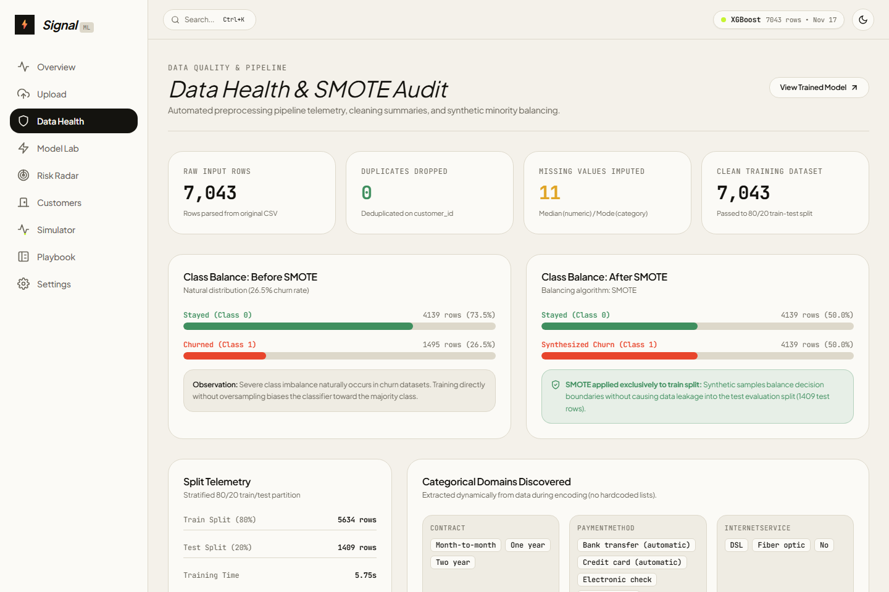
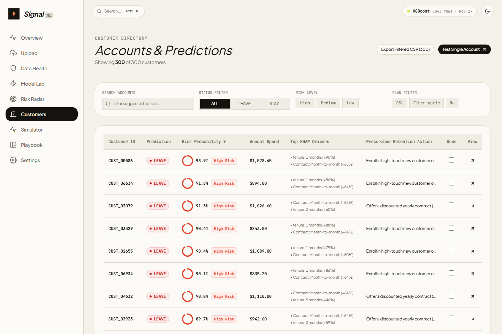
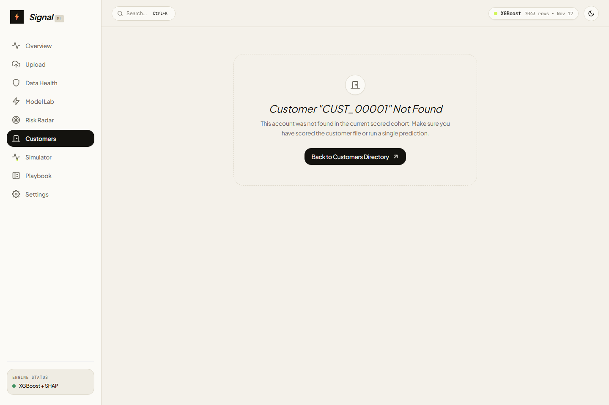
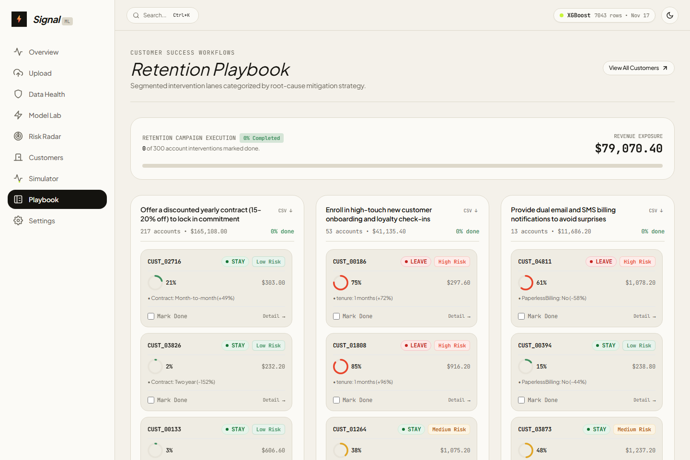
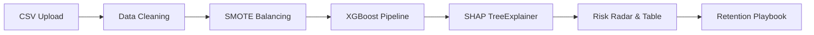

<div align="center">
  

  # PredictChurn

  > Detect customer churn early, explain why it happens with SHAP, and trigger retention actions.

  [](https://nextjs.org/)
  [](https://www.typescriptlang.org/)
  [](https://fastapi.tiangolo.com/)
  [](https://xgboost.readthedocs.io/)
  [](https://tailwindcss.com/)
  [](https://github.com/FLASH11025/customer-retention-system)
  [](https://opensource.org/licenses/MIT)

  <br><br>
  
</div>

---

### 💡 Why PredictChurn

Customer attrition quietly bleeds recurring revenue before account managers spot warning signs. PredictChurn bridges production machine learning with customer success operations by predicting churn probability and quantifying exact revenue exposure. Teams receive explainable local SHAP drivers and targeted retention playbooks to intervene before customers leave.

---

### ✨ Key Features

- **Automated CSV Ingestion (`/upload`):** In-browser header validation with dual-mode support for model retraining or cohort scoring.
- **Data Health & SMOTE Audit (`/data-health`):** Transparent record auditing, missing-value imputation, and synthetic oversampling for class balance.
- **Dynamic Threshold Calibration (`/model`):** Real-time client-side confusion matrix, ROC curve, and F1 recalculation across decision thresholds.
- **Executive Risk Radar (`/radar`):** Financial exposure tracking with live revenue-at-risk aggregation and risk-tier segmentation.
- **Customer Intelligence Table (`/customers`):** Searchable, filterable account roster with risk badges and full CRM-ready CSV export.
- **Explainable SHAP Dossiers (`/customers/[id]`):** Local TreeSHAP attribution translating raw feature weights into clear root-cause sentences.
- **Interactive What-If Simulator (`/simulator`):** Real-time single-account scenario testing with immediate probability feedback.
- **Actionable Retention Playbook (`/playbook`):** Kanban workspace organizing accounts into intervention tiers with revenue at stake.

---

### 📸 Screenshots Gallery

<table>
  <tr>
    <td width="50%">
      <br>
      <b>Overview & Conversion Hub</b> (<code>/</code>)
    </td>
    <td width="50%">
      <br>
      <b>Dataset Ingestion & Validation</b> (<code>/upload</code>)
    </td>
  </tr>
  <tr>
    <td width="50%">
      <br>
      <b>Data Health & SMOTE Audit</b> (<code>/data-health</code>)
    </td>
    <td width="50%">
      <br>
      <b>Model Evaluation & Threshold Slider</b> (<code>/model</code>)
    </td>
  </tr>
  <tr>
    <td width="50%">
      <br>
      <b>Executive Risk Radar</b> (<code>/radar</code>)
    </td>
    <td width="50%">
      <br>
      <b>Customer Intelligence Table</b> (<code>/customers</code>)
    </td>
  </tr>
  <tr>
    <td width="50%">
      <br>
      <b>SHAP Customer Deep-Dive</b> (<code>/customers/[id]</code>)
    </td>
    <td width="50%">
      <br>
      <b>What-If Risk Simulator</b> (<code>/simulator</code>)
    </td>
  </tr>
  <tr>
    <td width="50%">
      <br>
      <b>Retention Kanban Playbook</b> (<code>/playbook</code>)
    </td>
    <td width="50%">
      <br>
      <b>Settings & Data Export</b> (<code>/settings</code>)
    </td>
  </tr>
</table>

---

### 🧠 How It Works



<details>
<summary><b>Detailed Pipeline Specifications</b></summary>
<br>

- **Preprocessing & Balancing:** Median imputation for blank numeric charges, string quote-stripping, and SMOTE synthesis to correct the initial 73.5% Stay vs 26.5% Churn class imbalance.
- **Model Training:** Stratified K-Fold XGBoost Classifier reaching 0.843 ROC-AUC and 77.29% accuracy on held-out test records.
- **SHAP Attribution:** Local TreeSHAP decomposes predictions into marginal feature effects ($\phi_i$), mapped to human-readable drivers and prescriptive retention actions.
- **Financial Risk Modeling:** Aggregates exposure using $\sum (\text{MonthlyCharges} \times 12)$ for all accounts crossing the active decision threshold.
</details>

---

### 🧰 Tech Stack

<div align="center">
  &nbsp;&nbsp;&nbsp;&nbsp;
  &nbsp;&nbsp;&nbsp;&nbsp;
  &nbsp;&nbsp;&nbsp;&nbsp;
  &nbsp;&nbsp;&nbsp;&nbsp;
  &nbsp;&nbsp;&nbsp;&nbsp;
  &nbsp;&nbsp;&nbsp;&nbsp;
  
</div>

<br>

| Layer | Technologies |
|---|---|
| **Frontend** | Next.js 14 (App Router), TypeScript (Strict), Tailwind CSS ("Signal" Theme), Zustand |
| **Backend & ML** | Python 3.10+, FastAPI, Uvicorn, XGBoost 3.x, SHAP 0.54, Imbalanced-Learn (SMOTE), Scikit-Learn |
| **Testing & Tooling** | Vitest (16 unit tests), ESLint, Puppeteer-Core |

```yaml
dataset: "IBM Telco Customer Churn (OpenML #42178)"
records: "7,043 customers, 20 feature columns"
model: "XGBoost Classifier + SMOTE + TreeSHAP"
metrics: "ROC-AUC 0.843 | Accuracy 77.29% | F1 0.618"
design_system: "Signal (Paper #F4F1EA, Night Desk #0E0F0C)"
```

---

### 🏗️ Architecture

```
customer-retention-system/
├── app/                  # Next.js App Router (10 views, layouts, error boundaries)
├── components/           # Reusable UI primitives & Signal layout components
├── lib/                  # Typed API client, Zustand store, CSV parser & metrics
├── predictchurn/         # FastAPI application, XGBoost pipeline & SHAP explainer
│   ├── api.py            # REST endpoints (/train, /predict, /predict-one, /metrics)
│   ├── churn_model.py    # Training logic, SMOTE oversampling & TreeSHAP
│   └── data/             # Training and evaluation CSV datasets
├── tests/                # Vitest unit test suite (16 tests)
└── docs/screenshots/     # High-resolution application screenshots
```

---

### 🚀 Quick Start

```bash
# 1. Clone the repository
git clone https://github.com/FLASH11025/customer-retention-system.git
cd customer-retention-system

# 2. Start the Python Backend
cd predictchurn
pip install -r requirements.txt
python train.py data/telco_training.csv
python -m uvicorn api:app --host 0.0.0.0 --port 8000

# 3. Start the Next.js Frontend (in a new terminal at project root)
cd ..
cp .env.local.example .env.local
npm install
npm run build && npm start -- -p 3000
```

Open **[http://localhost:3000](http://localhost:3000)** in your browser.

---

### 🧪 Testing

```bash
npm test -- --run    # Run 16 Vitest unit tests (CSV, metrics, formatting)
npm run typecheck    # Strict TypeScript type safety validation
npm run lint         # ESLint code standards check
```

---

### 🗺️ Roadmap

- [ ] Docker & Docker-Compose one-command containerization
- [ ] Role-based access control (RBAC) & OAuth2 user authentication
- [ ] Bi-directional webhooks for HubSpot and Salesforce CRM synchronization
- [ ] Automated recurring model retraining with data drift monitoring

---

### 🤝 Contributing

Contributions are welcome! Please fork this repository, create a descriptive feature branch (`git checkout -b feat/your-feature`), commit your changes, and open a Pull Request.

---

### 📄 License

Distributed under the MIT License. See [LICENSE](LICENSE) for details.

---

### 📬 Contact

<div align="center">
  <a href="https://github.com/FLASH11025"></a>&nbsp;&nbsp;
  <a href="https://linkedin.com/in/YOUR_LINKEDIN"></a>&nbsp;&nbsp;
  <a href="mailto:your.email@example.com"></a>
</div>

<br>

<div align="center">
  
</div>
