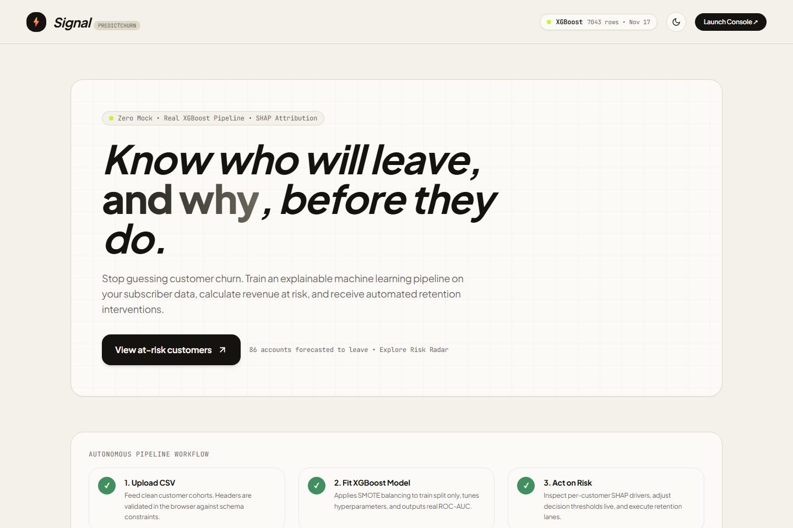
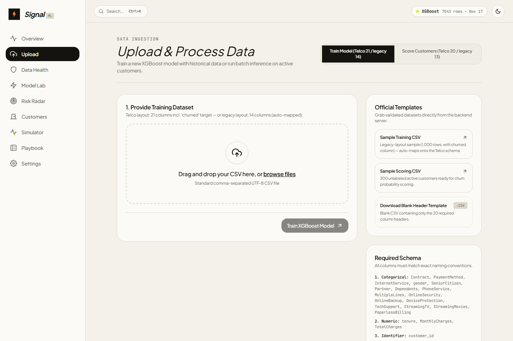
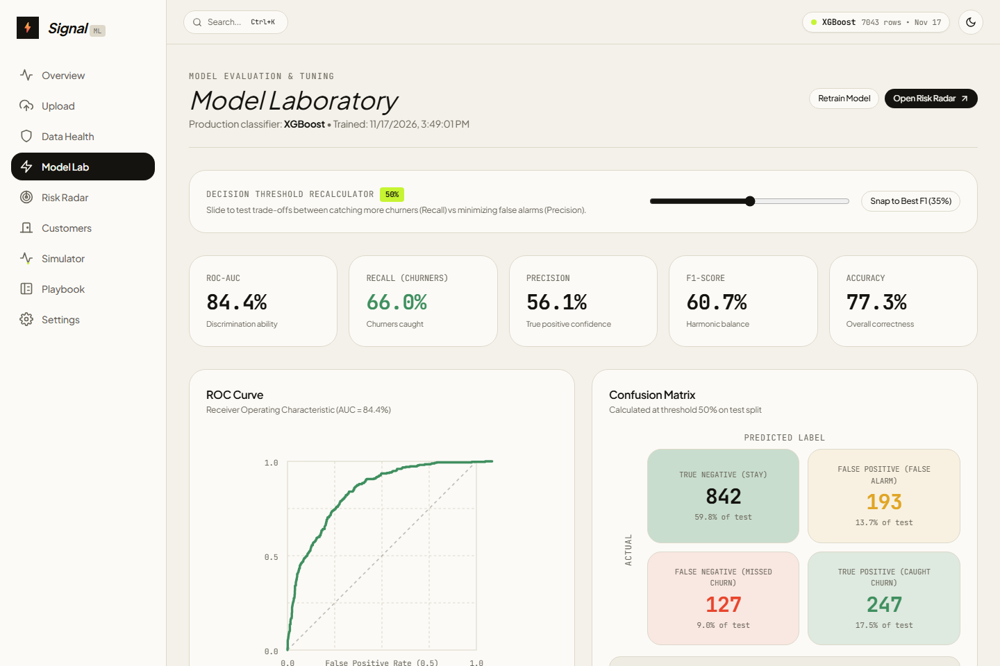
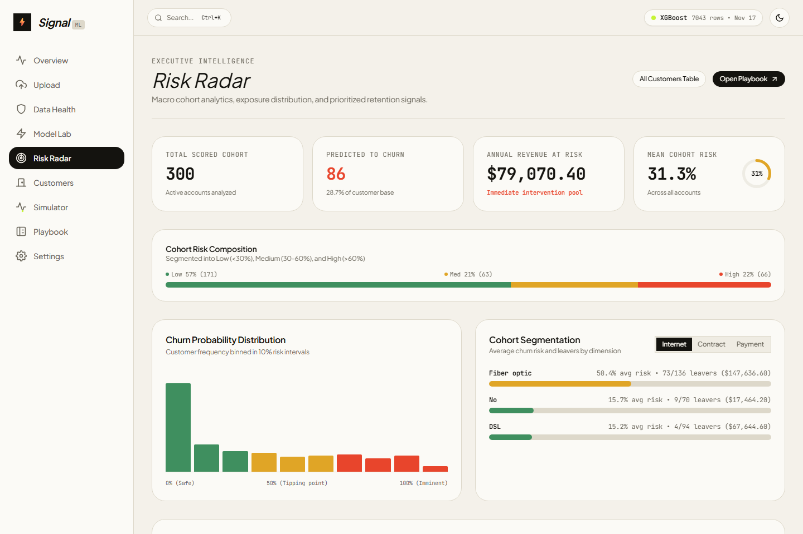
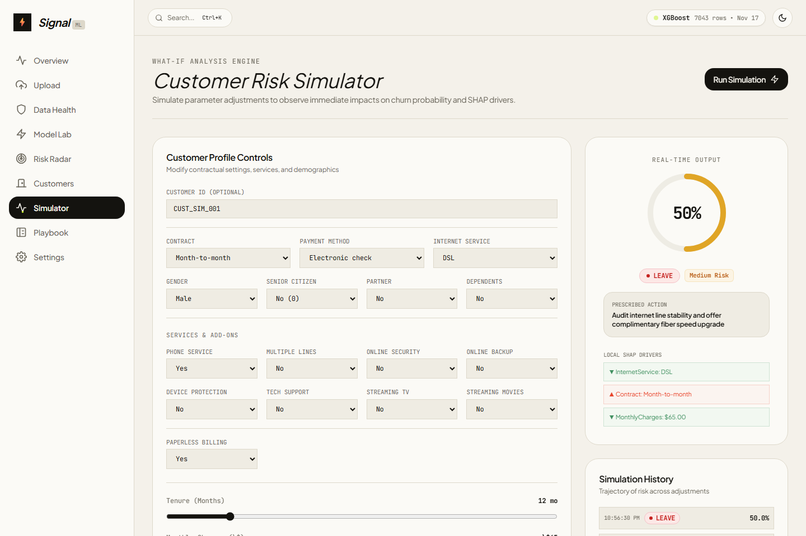
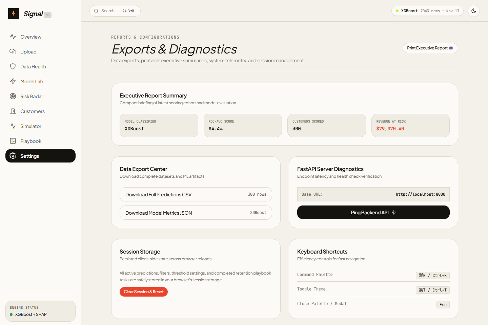

# PredictChurn — Customer Churn Intelligence System

PredictChurn is an end-to-end, production-grade churn intelligence web application designed to help businesses detect customer attrition early, understand the exact factors driving churn, and take automated retention actions.

- 🐍 **ML Backend:** Python · FastAPI · XGBoost 3.x · SHAP TreeExplainer · SMOTE · Scikit-Learn
- ⚡ **Web Frontend:** Next.js 14 (App Router) · TypeScript (Strict) · Tailwind CSS · Zustand
- 📊 **Dataset:** IBM Telco Customer Churn (7,043 customers, 20 feature columns)
- 🎨 **Visual Identity:** "Signal" (Warm Paper `#F4F1EA` & Night Desk `#0E0F0C`, Risk Spectrum colors, Instrument Serif display typography)

---

## 📸 Visual Walkthrough & System Architecture

### 1. Overview & Conversion Hub (`/`)



#### Purpose:
The landing section serves as the primary executive cockpit and value-proposition center. It provides immediate high-level awareness of the system's current trained model state, model accuracy, and real-time retention ROI.

#### How It Works:
- **Live Model Polling:** On mount, the component queries `GET /metrics` via the typed client (`lib/api.ts`).
- **Telemetry Verification:** If a model is active, it displays the algorithm (`XGBoost`), overall ROC-AUC (`0.843`), Accuracy (`77.29%`), and cross-validated stability scores.
- **Dynamic Routing:** Offers one-click primary call-to-actions (CTAs) directing users to either retrain a model on new telemetry or score a fresh customer cohort.

---

### 2. Dataset Ingestion & Validation (`/upload`)



#### Purpose:
Enables dual-mode file ingestion: **Train Mode** (trains and tunes a new machine learning model) and **Score Mode** (runs bulk inference on customer accounts).

#### How It Works:
- **Client-Side CSV Validation:** `lib/csv.ts` parses and inspects incoming CSV headers in the browser before upload, confirming all 20 required Telco features (`Contract`, `tenure`, `MonthlyCharges`, `PaymentMethod`, etc.) and the target `churned` column (for training).
- **Multipart Streaming:** Dispatches multipart form data to `POST /train` or `POST /predict?threshold=0.5`.
- **Live Preview:** Displays the first 5 records in a tabular preview with data-type badges and row counts.
- **Template Generation:** Provides one-click downloads of validated training sample CSVs and scoring templates directly from FastAPI (`/sample-csv` and `/template-csv`).

---

### 3. Data Health & Cleaning Audit (`/data-health`)


#### Purpose:
Ensures complete transparency into data pre-processing, data sanitization, and class balancing prior to model training.

#### How It Works:
- **Cleaning Pipeline Audit:** Displays metrics returned in `metrics.cleaning`:
  - `rows_in` vs `rows_out`
  - Duplicate customer records identified and purged
  - Missing value imputation summary (e.g. `TotalCharges` median imputation for new tenures)
  - String sanitization (stripping quotation marks from OpenML categoricals)
- **Class Balance (SMOTE):** Displays the raw churn imbalance ratio (e.g., 73.5% Stay vs 26.5% Churn) and the synthetic oversampling applied by SMOTE during training to prevent majority-class bias.

---

### 4. Model Evaluation & Dynamic Thresholding (`/model`)



#### Purpose:
Provides deep diagnostic visibility into the classifier's performance and allows operators to adjust decision thresholds interactively.

#### How It Works:
- **Interactive Threshold Slider:** Allows operators to slide the classification threshold between `0.05` and `0.95`.
- **Client-Side Re-computation:** Using `lib/metrics.ts`, the frontend iterates over the held-out test cohort probabilities (`metrics.test_probabilities`) in real-time ($O(N)$ execution), recalculating:
  - Confusion Matrix ($TN, FP, FN, TP$)
  - Precision, Recall, and $F_1$ Score
  - Trade-off indicator showing optimal $F_1$ threshold
- **ROC Curve:** SVG visualization plotting True Positive Rate (Sensitivity) vs False Positive Rate ($1 - \text{Specificity}$) with area-under-curve score.

---

### 5. Risk Radar Dashboard (`/radar`)



#### Purpose:
High-level strategic command center summarizing aggregate churn exposure across an entire customer cohort.

#### How It Works:
- **Revenue at Risk Calculation:** Computed dynamically as:
  $$\text{Revenue at Risk} = \sum_{i \in \text{Predicted Churners}} (\text{MonthlyCharges}_i \times 12)$$
- **KPI Bento Grid:** Displays Total Accounts, Predicted to Leave count, Average Churn Risk %, and High-Risk accounts.
- **Risk Distribution Histogram:** Bins customer probabilities into calibrated risk buckets:
  - 🟢 **Safe:** $0\% - 35\%$
  - 🟡 **Watch:** $35\% - 65\%$
  - 🔴 **Danger:** $65\% - 100\%$

---

### 6. Customer Intelligence Table (`/customers`)


#### Purpose:
Granular customer-by-customer database featuring search, multi-factor filtering, risk badge categorization, and export capabilities.

#### How It Works:
- **Filtering & Search:** Real-time search across Customer IDs and multi-select filtering across Contract types, Payment Methods, and Risk Tiers.
- **Risk Badging:** Uses `components/ui/Badge.tsx` with dynamic micro-pulses for critical accounts.
- **Prescribed Action:** Displays the top recommended retention action tailored to each account.
- **CSV Export:** Generates an enriched CSV file with risk probabilities, risk levels, and top SHAP reasons for external CRM/marketing automation sync.

---

### 7. Customer Deep-Dive & SHAP Explainability (`/customers/[id]`)


#### Purpose:
Individual account dossier revealing the exact mathematical factors driving a specific customer's churn risk.

#### How It Works:
- **SHAP (SHapley Additive exPlanations):** Calculates local feature importances using tree-based Shapley values:
  $$\phi_i(x) = \sum_{S \subseteq F \setminus \{i\}} \frac{|S|!(|F| - |S| - 1)!}{|F|!} \left[ f_x(S \cup \{i\}) - f_x(S) \right]$$
- **Human-Readable Reasons:** Converts mathematical SHAP weights into actionable sentences (e.g. `▲ Month-to-month contract increases risk`, `▼ Tenure > 24 months reduces risk`).
- **Cohort Comparison:** Compares this customer's Monthly Charges and Tenure against median statistics of safe vs churned peers.

---

### 8. What-If Risk Simulator (`/simulator`)



#### Purpose:
Interactive experimentation sandbox allowing customer success managers to simulate changes to contracts, pricing, or service add-ons and immediately observe the effect on churn probability.

#### How It Works:
- **Real-Time Single Inference:** Collects 19 inputs (Contract, Payment Method, Tenure, Monthly Charges, Tech Support, Online Security, etc.) and issues a `POST /predict-one` request to FastAPI.
- **Immediate Feedback Loop:** The server encodes features, executes XGBoost tree inference, and computes localized TreeSHAP values in milliseconds.
- **History Trajectory:** Logs successive parameter tweaks in a session audit log so users can see how offering discounts or add-ons shifts probability downward.

---

### 9. Retention Kanban Playbook (`/playbook`)


#### Purpose:
Operational workflow board organizing at-risk accounts into manageable intervention tiers with actionable playbooks.

#### How It Works:
- **Three Strategic Tiers:**
  - 🔴 **High Risk (>65%):** Immediate 1-on-1 account executive outreach, contract restructuring, rate lock discounts.
  - 🟡 **Medium Risk (35%-65%):** Targeted automated email sequences, feature adoption onboarding, complimentary add-on trials.
  - 🟢 **Low Risk (<35%):** Standard loyalty nurturing and cross-sell campaigns.
- **Task Management:** Interactive checkboxes track completed outreach with state persisted in browser storage.
- **Segment Export:** Export individual lane CSVs directly to marketing platforms.

---

### 10. System Configuration & Data Export (`/settings`)



#### Purpose:
System administration, backend connectivity diagnostics, global data reset, and complete dataset exports.

#### How It Works:
- **Health Checks:** Pings `http://localhost:8000/metrics` to verify backend uptime, response latency, and active model bundle version.
- **Session Reset:** Clears local caches (`predictchurn-storage-v2`) to simulate fresh onboarding flows.
- **Export Center:** Download raw evaluation metrics, test probabilities, and scored customer batches as JSON or CSV.

---

## 🛠️ Tech Stack & Implementation Details

| Layer | Component | Description |
|---|---|---|
| **Machine Learning** | `XGBoost 3.2` | Gradient boosted decision trees optimized for tabular churn classification. |
| **Explainability** | `SHAP 0.54` | TreeExplainer computing exact Shapley feature attribution. |
| **Data Resampling** | `imbalanced-learn` | SMOTE synthetic oversampling balancing minority churn class. |
| **API Framework** | `FastAPI + Uvicorn` | Asynchronous REST service with Pydantic validation and CORS. |
| **Frontend Framework** | `Next.js 14 (App Router)` | Modern React Server Components with client hydration. |
| **Language** | `TypeScript (Strict)` | End-to-end typed API contracts and UI state. |
| **State Management** | `Zustand` | Lightweight reactive store with `localStorage` persistence. |
| **Styling** | `Tailwind CSS` | Custom token-driven design system with dark/light themes. |
| **Testing** | `Vitest` | 16 unit tests verifying schema validation, metric recalculation, and formatters. |

---

## 🚀 Getting Started

### 1. Prerequisites
- **Python 3.10+** (Python 3.14 compatible)
- **Node.js 18+** & **npm**

### 2. Backend Setup

```bash
cd predictchurn
pip install -r requirements.txt

# Train the model on the Telco dataset
python train.py data/telco_training.csv

# Launch the FastAPI server
python -m uvicorn api:app --host 0.0.0.0 --port 8000
```

### 3. Frontend Setup

```bash
# In the project root directory
npm install
npm run build
npm start -- -p 3000
```

Open **[http://localhost:3000](http://localhost:3000)** in your browser.

---

## 🧪 Running Tests

```bash
# Run Vitest test suite
npm test -- --run

# Run TypeScript typecheck
npm run typecheck

# Run ESLint validation
npm run lint
```

---

## 📄 License
MIT License. Built for real-world customer churn intelligence and revenue retention.
